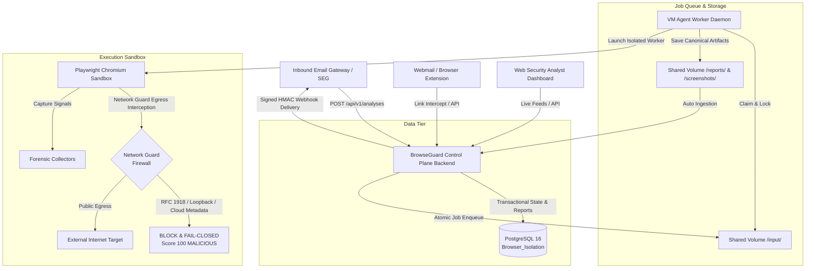

# BrowseGuard System Architecture & Engineering Blueprint

## 1. Executive Summary

**BrowseGuard** is an enterprise-grade Browser Isolation & Dynamic URL Threat Analysis platform designed to neutralize zero-day web attacks, credential phishing, and Server-Side Request Forgery (SSRF) exploits. It intercepts untrusted links from automated Email Security Gateways (SEGs) and client endpoints, executes them in ephemeral, isolated headless Chromium sandboxes, and transactionally persists rich canonical forensic reports into PostgreSQL.

---

## 2. High-Level Architecture Topology

---

## 3. Core Subsystems

### 3.1 Control Plane Backend (Node.js & Express)
- **API Version 1 (`/api/v1/analyses`)**: Full programmatic CRUD and status polling for automated email gateways and SIEM/SOAR platforms.
- **Authentication & Multi-Tenancy**: API-key scoped authorization (`X-API-Key` or `Authorization: Bearer`), organization-level isolation, and dynamic quota enforcement.
- **Idempotency Guard**: Prevents redundant re-scans using SHA-256 idempotency key replays.
- **Asynchronous Webhook Engine**: Delivers signed HMAC-SHA256 callbacks to registered webhooks upon report finalization, recorded with full audit trails in PostgreSQL `audit_events`.

### 3.2 Dynamic Worker Sandbox & Egress Isolation (Python 3.12 & Playwright)
- **Zero-Trust Network Guard (`network_guard.py`)**: Intercepts every network route before outgoing packets leave the worker. Enforces strict SSRF isolation against:
  - Private IPv4/IPv6 networks (RFC 1918 subnets `10.0.0.0/8`, `172.16.0.0/12`, `192.168.0.0/16`)
  - Loopback (`127.0.0.0/8`, `::1`)
  - Cloud Instance Metadata Services (`169.254.169.254`, `169.254.170.2`, `metadata.google.internal`)
  - Carrier-grade NAT (`100.64.0.0/10`)
  - DNS rebinding tricks resolving to prohibited IP addresses
- **Telemetry & Forensics Collection**:
  - `headers_collector.py`: HTTP request/response headers, security posture (`HSTS`, `CSP`, `X-Frame-Options`).
  - `forms_collector.py`: Password and credential input harvesting detection.
  - `javascript_collector.py`: Uncaught errors, dynamic eval, anti-analysis obfuscation.
  - `cookie_collector.py`: Tracking, session, and third-party cookies.
  - `certificate_collector.py`: SSL/TLS certificate chains, issuer validity, and expiration.
- **Explainable Threat Analyzer (`threat_analyzer.py` & `brand_detector.py`)**:
  - Deterministic rule engine assigning scored threat findings.
  - **Brand Impersonation Detection**: Identifies deceptive claims to Microsoft, Google, PayPal, Apple, Amazon, and Banking brands hosted on unauthorized domains (`BRAND-001`).
  - **Typosquatting & Homoglyphs**: Punycode (`xn--`) and Levenshtein lookalike domain classification (`TYPO-001`).
  - **Cloud-Hosted Phishing**: Detects credential forms hosted on public SaaS platforms (Firebase, Vercel, Netlify, Cloudflare Pages) (`PHISH-005`).
  - **Data Exfiltration Interception**: Blocks credential forms routing to Telegram bots or Discord webhooks (`EXFIL-001`).
  - Output verdicts: `SAFE`, `SUSPICIOUS`, `HIGH_RISK`, `MALICIOUS`.

### 3.3 Interactive Remote Browser Isolation (RBI) Engine (`rbi_server.py`)
- **Zero-Trust Visual Streaming**: Attaches Chrome DevTools Protocol (CDP) `Page.startScreencast` to stream low-latency JPEG pixel frames to client canvases over WebSockets.
- **Client Input Translation**: Translates client mouse clicks, movements, wheel scrolling, and keyboard keystrokes via CDP `Input.dispatchMouseEvent` and `Input.dispatchKeyEvent`.
- **Zero Client Attack Surface**: The client endpoint executes zero HTML/JS/CSS from untrusted destinations—only safe video/pixel frames reach the browser. All network packets pass through `network_guard.py` SSRF filters.

---

## 4. PostgreSQL Relational Data Tier

BrowseGuard uses a normalized PostgreSQL schema (`Browser_Isolation`) as its single source of truth:

| Table Name | Description |
|---|---|
| `organizations` | Multi-tenant tenant boundaries, tier configurations, and account state |
| `api_clients` | Integration API keys, rate limits, concurrent scan limits, and quotas |
| `analyses` | Master analysis records (URL, status, risk score, verdict, timing) |
| `findings` | Atomic security signals detected by the rule analyzer |
| `redirect_events` | Step-by-step HTTP and JavaScript redirection hops |
| `reports` | Canonical forensic reports (evidence summary, browser behaviour) |
| `artifact_records` | Screen captures, DOM dumps, network logs metadata and hashes |
| `audit_events` | Immutable security log of API access, scans, and webhook dispatches |
| `system_health` | Worker liveness, heartbeat telemetry, and queue metrics |
| `schema_migrations` | Versioned schema migration history tracking |

---

## 5. Security Architecture & Threat Model

1. **Host-to-Worker Separation**: The host backend never executes untrusted JavaScript or renders foreign DOM trees; untrusted content is strictly confined to the sandboxed Chromium worker.
2. **Fail-Closed SSRF Policy**: Any packet targeting an internal network or cloud metadata service is dropped at layer 7 before connection initiation. Rule `SSRF-001` or `SSRF-002` immediately flags the job as `MALICIOUS` with score 100.
3. **Database Isolation**: The sandbox worker has no database credentials and cannot talk to PostgreSQL directly; only the backend control plane interfaces with the database.
