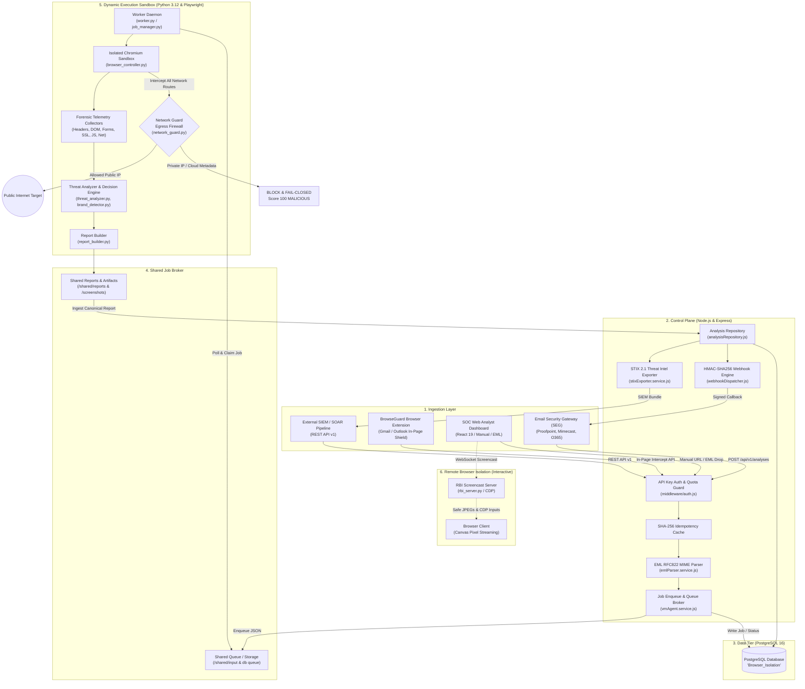

# BrowseGuard: Project Story, Core Architecture & Team Onboarding Guide

> **Document Purpose**: A foundational onboarding guide for new engineering team members. It details the origin story, threat landscape motivation, architectural philosophy, end-to-end telemetry lifecycle, and a module-by-module breakdown of the **BrowseGuard** platform.

---

## Table of Contents

1. [The Story Behind BrowseGuard: The Origin & The "Why"](#1-the-story-behind-browseguard-the-origin--the-why)
2. [The Threat Landscape We Fight](#2-the-threat-landscape-we-fight)
3. [Core Architectural Philosophy](#3-core-architectural-philosophy)
4. [High-Level Architecture Topology](#4-high-level-architecture-topology)
5. [Comprehensive Module Breakdown](#5-comprehensive-module-breakdown)
   - [5.1 Module 1: The Control Plane Backend (`backend/`)](#51-module-1-the-control-plane-backend-backend)
   - [5.2 Module 2: The Dynamic Sandbox & VM Agent (`vm-agent/`)](#52-module-2-the-dynamic-sandbox--vm-agent-vm-agent)
   - [5.3 Module 3: Remote Browser Isolation Engine (`rbi_server.py`)](#53-module-3-remote-browser-isolation-engine-rbi_serverpy)
   - [5.4 Module 4: Manifest V3 Browser Extension (`extension/`)](#54-module-4-manifest-v3-browser-extension-extension)
   - [5.5 Module 5: SOC Analyst Web Dashboard (`frontend/`)](#55-module-5-soc-analyst-web-dashboard-frontend)
   - [5.6 Module 6: PostgreSQL Normalized Relational Data Tier](#56-module-6-postgresql-normalized-relational-data-tier)
6. [Life of a URL Detonation: Step-by-Step Flow](#6-life-of-a-url-detonation-step-by-step-flow)
7. [New Developer Onboarding & Quickstart](#7-new-developer-onboarding--quickstart)
8. [Codebase Navigation & Essential File Map](#8-codebase-navigation--essential-file-map)

---

## 1. The Story Behind BrowseGuard: The Origin & The "Why"

In modern enterprise security, **email remains the #1 initial access vector** for targeted cyber attacks. Over 90% of data breaches, ransomware deployments, and credential harvesting incidents begin with an employee clicking a malicious link in an email or web message.

### The Historical Problem: Legacy Defenses Were Failing
For years, organizations relied on traditional security defenses:
1. **Static Blocklists and Reputation Feeds**: Attackers circumvent these effortlessly by registering brand-new domains ("newly registered domains" or NRDs) or abusing dynamic DNS minutes before launching an attack campaign.
2. **Static Link Rewriting & Time-of-Click Wrappers**: Legacy email filters rewrite links to route through vendor proxies. However, modern adversaries use **conditional redirection, anti-bot cloaking, and geo-fencing**. When the security vendor's scanner inspects the link, it sees an innocuous landing page; when the human victim clicks the link from an enterprise workstation, the exploit payload or credential harvesting page triggers.
3. **Local Endpoint Exposure**: If an employee navigates to a malicious URL, their local browser executes untrusted JavaScript, parses malicious DOM structures, processes web exploits, or falls victim to realistic social engineering lures (such as modern "ClickFix" or OAuth device code phishing).

### The Inception of BrowseGuard
BrowseGuard was conceived to solve this fundamental asymmetry. Instead of guessing whether a link is malicious based on static metadata or letting untrusted code run near sensitive enterprise assets, **BrowseGuard creates a disposable, zero-trust execution boundary**:

1. **Isolation First**: Untrusted links are never loaded on the user's host machine. Instead, they are quarantined and detonated in an ephemeral, headless, hardened Chromium sandbox running in a strictly controlled container or VM environment.
2. **Behavioral Telemetry Over Reputation**: Rather than asking "Has anyone reported this domain before?", BrowseGuard asks:
   - *What does this page actually do when it loads?*
   - *Does it render password forms on a newly minted domain pretending to be Microsoft 365?*
   - *Does it exfiltrate collected credentials to a Telegram bot or Discord webhook?*
   - *Does it attempt to trick the employee into pasting a malicious PowerShell command into their Windows Run dialog (ClickFix)?*
   - *Does it attempt to pivot internally against private IP ranges or cloud metadata endpoints (`169.254.169.254`)?*
3. **Deterministic, Explainable Scoring**: Machine learning models often produce black-box scores that SOC analysts cannot explain to leadership. BrowseGuard relies on an explainable, deterministic scoring engine where every threat verdict links directly to captured, immutable forensic evidence (DOM structures, screenshot frames, network logs, and SSL certificates).

---

## 2. The Threat Landscape We Fight

BrowseGuard actively defends against multiple sophisticated attack classes:

| Threat Category | Attack Mechanism | BrowseGuard Defense & Detection |
|---|---|---|
| **Credential Harvesting & Brand Impersonation** | Threat actors clone Microsoft, Google Workspace, Apple, PayPal, or internal SSO login portals on lookalike domains. | `brand_detector.py` compares page titles, logos, DOM form inputs, and visual signatures against recognized brands on unauthorized domains (`BRAND-001`). |
| **Typosquatting & Homoglyphs** | Using Punycode (`xn--`), visual lookalike characters (Cyrillic `а` for Latin `a`), or single-character omissions (e.g., `micros0ft.com`). | `detect_typosquatting` computes Levenshtein distances and Punycode decodings against protected enterprise domains (`TYPO-001`). |
| **Cloud-Hosted Phishing (SaaS Abuse)** | Phishing kits hosted on trusted cloud hosting providers (Firebase, Vercel, Supabase, Cloudflare Pages, Netlify) to bypass domain reputation checks. | `detect_cloud_hosted_phishing` flags sensitive credential input fields when hosted on shared developer subdomains (`PHISH-005`). |
| **Server-Side Request Forgery (SSRF)** | Attackers send links designed to trick sandbox crawlers into querying internal RFC 1918 subnets or Cloud Instance Metadata (`169.254.169.254`) to steal IAM roles. | `network_guard.py` acts as a fail-closed egress firewall, dropping packets at Layer 7 and immediately flagging `SSRF-001` (Score 100). |
| **Modern "ClickFix" & Scareware Lures** | Fake CAPTCHA or Cloudflare verification pages instructing victims to press `Win + R`, paste a PowerShell command, and hit Enter. | `advanced_heuristics.py` parses DOM text for clipboard hijacking, fake update prompts, and Windows Run command instructions (`CLICKFIX-001`). |
| **OAuth Device Phishing** | Abuse of OAuth 2.0 Device Authorization Grant flows (e.g., `microsoft.com/devicelogin`) to hijack corporate tokens without collecting passwords. | `detect_oauth_device_phishing` inspects user-code input prompts paired with high-risk redirect patterns (`OAUTH-001`). |
| **Webhook Data Exfiltration** | Threat forms submitting stolen credentials directly to Telegram Bot APIs, Discord Webhooks, or anonymous pastebins. | `detect_exfiltration_endpoints` monitors all outgoing form actions and asynchronous `fetch`/`XMLHttpRequest` targets (`EXFIL-001`). |

---

## 3. Core Architectural Philosophy

When building or extending BrowseGuard, every engineer must adhere to four core tenets:

1. **Fail-Closed Zero-Trust Egress**: The sandbox environment must never be allowed to probe private corporate networks, loopback addresses, or cloud metadata endpoints. Any attempt to access restricted IP space immediately terminates the session and scores the URL as `MALICIOUS` (Score: 100).
2. **Host-Worker Isolation**: Untrusted JavaScript, CSS, or DOM elements are strictly quarantined inside the sandboxed Chromium worker process. The Control Plane Backend (`Node.js`) and database (`PostgreSQL`) never execute untrusted web payloads.
3. **Deterministic & Explainable Findings**: Every risk score must be mathematically traceable to observable browser signals. An analyst or client can see exact rule IDs (e.g., `BRAND-001`, `SSRF-001`, `PHISH-002`), severities, and associated forensic evidence.
4. **Relational Truth & Auditability**: System state is not kept in volatile memory or transient file caches. PostgreSQL serves as the canonical source of truth for organizations, API keys, analyses, findings, redirect chains, reports, and SIEM audit trails.

---

## 4. High-Level Architecture Topology



---

## 5. Comprehensive Module Breakdown

### 5.1 Module 1: The Control Plane Backend (`backend/`)
- **Technology Stack**: Node.js 20, Express, PostgreSQL (`pg` connection pool), WebSockets (`ws`).
- **Directory Path**: `backend/src/`
- **Primary Responsibilities**:
  1. **Enterprise REST API v1 (`routes/v1/analyses.routes.js`)**: Provides programmatic endpoints for automated email gateways and enterprise integrations.
  2. **Security & Quotas (`middleware/auth.js`, `middleware/gatewayAuth.js`)**: Enforces organization-scoped API keys (`X-API-Key`), rate limits, and scan quotas.
  3. **Idempotency Guard**: Replays cached analysis results when an identical `idempotency_key` is submitted, preventing duplicate detonations of identical email links.
  4. **EML Detonation Engine (`services/emlParser.service.js`)**: Parses RFC 822 email files, evaluates SPF/DKIM/DMARC authentication headers, strips attachments, and extracts embedded URLs for automated batch analysis.
  5. **Signed Webhook Dispatcher (`services/webhookDispatcher.js`)**: Dispatches HMAC-SHA256 cryptographically signed callbacks to notify upstream email gateways (e.g., Proofpoint, Mimecast) when an analysis is completed.
  6. **STIX 2.1 Threat Intel Exporter (`services/stixExporter.service.js`)**: Formats findings, indicators of compromise (IOCs), domains, and IP addresses into standard STIX bundles for ingestion into SIEM/SOAR platforms (Splunk, Sentinel, MISP).
  7. **Trusted Vendors Fast-Pass (`services/trustedVendor.service.js`)**: Validates known, verified SaaS providers and invoicing platforms, accelerating scan workflows while maintaining security.

### 5.2 Module 2: The Dynamic Sandbox & VM Agent (`vm-agent/`)
- **Technology Stack**: Python 3.12, Playwright, Chromium, AsyncIO.
- **Directory Path**: `vm-agent/`
- **Primary Responsibilities**:
  1. **Autonomous Worker Daemon (`worker.py` & `services/job_manager.py`)**: Continuously polls the PostgreSQL queue and filesystem `/input/` queue for pending detonation jobs, applying file locks to prevent race conditions.
  2. **Zero-Trust Network Guard Firewall (`services/network_guard.py`)**: Intercepts every single HTTP and WebSocket request before it leaves the browser sandbox. Blocks:
     - RFC 1918 Private subnets (`10.0.0.0/8`, `172.16.0.0/12`, `192.168.0.0/16`)
     - Loopback (`127.0.0.0/8`, `::1`)
     - Cloud Metadata Services (`169.254.169.254`, `169.254.170.2`, `metadata.google.internal`)
     - Carrier-Grade NAT (`100.64.0.0/10`)
     - DNS rebinding attacks resolving to prohibited IPs.
  3. **Deep Forensic Telemetry Collectors (`collectors/`)**:
     - `headers_collector.py`: Request/response headers, HSTS, CSP, and X-Frame-Options policies.
     - `forms_collector.py`: Scans DOM for input types (password, credit card, SSN, OTP tokens).
     - `javascript_collector.py`: Captures runtime eval statements, dynamically injected scripts, and anti-analysis cloaks.
     - `cookie_collector.py`: Audits session cookies, tracking pixels, and unauthorized third-party trackers.
     - `certificate_collector.py`: Evaluates SSL/TLS certificates, issuer validity, and lifespan.
     - `redirect_collector.py`: Tracks HTTP 3xx, meta-refresh, and JavaScript `window.location` redirect chains.
     - `download_collector.py`: Captures drive-by download attempts, hashes binaries with SHA-256, and checks file extensions.
  4. **Threat Analyzer & Decision Engine (`services/threat_analyzer.py`, `services/brand_detector.py`)**:
     - Executes over 50+ deterministic security rules.
     - Maps observable signals to findings with standardized codes (`BRAND-001`, `TYPO-001`, `SSRF-001`, `CLICKFIX-001`, `PHISH-005`, etc.).
     - Computes normalized risk scores (0–100) and assigns canonical verdicts: `SAFE`, `SUSPICIOUS`, `HIGH_RISK`, `MALICIOUS`.
  5. **Canonical Report Builder (`services/report_builder.py`)**: Synthesizes telemetry into a consolidated forensic JSON report, accompanied by high-resolution full-page screenshot artifacts.

### 5.3 Module 3: Remote Browser Isolation Engine (`rbi_server.py`)
- **Technology Stack**: Python, Playwright, Chrome DevTools Protocol (CDP), WebSockets.
- **Directory Path**: `vm-agent/rbi_server.py` & `backend/src/services/rbiManager.service.js`
- **Primary Responsibilities**:
  - Enables **Interactive Browser Isolation (RBI)** for security analysts who need to safely interact with a suspicious webpage without exposing their local browser.
  - Attaches to Chrome DevTools Protocol (`Page.startScreencast`) to capture live browser frames and stream them as low-latency JPEG pixels over WebSockets.
  - Intercepts analyst mouse moves, clicks, scrolling, and keystrokes from the web frontend canvas and dispatches them via CDP (`Input.dispatchMouseEvent`, `Input.dispatchKeyEvent`).
  - **Zero Endpoint Attack Surface**: The analyst's workstation renders zero remote HTML, CSS, or JavaScript. All rendering and network execution happens inside the sandbox container.

### 5.4 Module 4: Manifest V3 Browser Extension (`extension/`)
- **Technology Stack**: JavaScript (ES6+), Manifest V3 Service Worker, Content Scripts.
- **Directory Path**: `extension/`
- **Primary Responsibilities**:
  - **Zero-Trust Link Interception**: Watches for link clicks within webmail applications (Gmail, Outlook 365) and regular web browsing.
  - **In-Page Safety Inspection**: Allows users to right-click any link and select *"Check Link Safety"* to trigger a sandbox evaluation without leaving their current tab.
  - **Quarantine Warning Modal**: If a link is evaluated as `SUSPICIOUS` or `MALICIOUS`, the extension interrupts navigation, overlays a threat warning with the risk score and findings, and allows the employee to abort navigation or view the forensic report.
  - **Popup Quick Threat Scanner**: Provides a toolbar interface showing real-time statistics of links scanned and threats neutralized, with a manual URL detonation bar.

### 5.5 Module 5: SOC Analyst Web Dashboard (`frontend/`)
- **Technology Stack**: React 19, Vite, Lucide Icons, Vanilla CSS Design System.
- **Directory Path**: `frontend/src/`
- **Primary Responsibilities**:
  - **Real-Time SOC Live Detonation Feed**: Visualizes scans as they happen with real-time polling and live WebSocket streaming.
  - **Interactive Threat Dial & Risk Scoring**: Renders color-coded risk dials (0–100) and severity badges for instant analyst triage.
  - **Forensic Pipeline Stepper**: Inspects HTTP redirect chains, headers, SSL certificate trees, and captured DOM structures.
  - **Screenshot & Evidence Viewer**: Renders full-resolution visual snapshots of target pages captured in the isolated sandbox.
  - **EML Detonation Studio**: Allows drag-and-drop analysis of raw email files with extracted link summaries and threat evaluations.
  - **Executive & STIX 2.1 Export**: Generates executive PDF/HTML threat summary reports and exports STIX threat intelligence bundles with a single click.

### 5.6 Module 6: PostgreSQL Normalized Relational Data Tier
- **Technology Stack**: PostgreSQL 16+, Schema Migrations in `backend/src/db/migrations/`
- **Directory Path**: `backend/src/db/`
- **Key Tables**:
  - `organizations`: Multi-tenant boundary, subscription tiers, and scan quotas.
  - `api_clients`: API keys, rate limits, and client permissions.
  - `analyses`: Master record for every detonation job (URL, status, risk score, verdict, timings).
  - `findings`: Individual atomic security violations (rule ID, category, severity, score weight, evidence payload).
  - `redirect_events`: Chronological hops in the HTTP/JS redirect chain with status codes and latency.
  - `reports`: Full canonical forensic JSON payload.
  - `artifact_records`: Screenshots, DOM dumps, and downloaded binary artifacts with SHA-256 checksums.
  - `audit_events`: Immutable audit trail of every API action, login, and webhook dispatch.
  - `system_health`: Worker heartbeats and queue telemetry.

---

## 6. Life of a URL Detonation: Step-by-Step Flow

To understand how the codebase works together, trace the journey of an untrusted link:

```
[1. Submission] 
   └── Email Gateway or User submits: POST /api/v1/analyses {"url": "https://suspicious-domain.com"}
[2. Ingestion & Authentication]
   └── Backend validates API key, verifies quota, and checks SHA-256 idempotency cache.
   └── A master analysis record is written to PostgreSQL table 'analyses' with status 'QUEUED'.
[3. Queue & Worker Claim]
   └── A job descriptor JSON is written to shared volume '/input/' (or PostgreSQL queue).
   └── vm-agent 'worker.py' claims the job and transitions DB status to 'RUNNING'.
[4. Sandbox Launch & Egress Check]
   └── Playwright initializes an isolated, headless Chromium browser context.
   └── 'network_guard.py' intercepts the initial navigation and DNS resolution.
   └── If the URL resolves to internal/cloud metadata -> Immediate drop, Rule SSRF-001, Score 100.
[5. Dynamic Execution & Telemetry Collection]
   └── The page loads in Chromium. Redirects, scripts, and network packets are observed.
   └── 10+ collectors record HTTP headers, SSL certificates, cookies, console logs, and form fields.
   └── High-resolution screenshot is captured and saved to '/screenshots/'.
[6. Rule Analysis & Scoring]
   └── 'threat_analyzer.py' runs collected telemetry against 50+ detection rules:
       - Brand impersonation (Microsoft login on unauthorized host)
       - Typosquatting / Homoglyph
       - Exfiltration endpoints (Telegram/Discord form actions)
       - ClickFix / Scareware / Fake updates
   └── A normalized risk score (0-100) and canonical verdict (e.g., MALICIOUS) are assigned.
[7. Canonical Report Generation & Storage]
   └── 'report_builder.py' compiles the complete report JSON into '/reports/'.
   └── The backend ingests the report and persists findings, redirects, and artifacts to PostgreSQL.
[8. Alerting & Consumption]
   └── If a 'callback_url' was specified, backend sends a cryptographically signed HMAC-SHA256 webhook.
   └── The React frontend SOC dashboard receives the completed record via live polling.
   └── Upstream Email Gateway quarantines the email or rewrites the link based on the verdict.
```

---

## 7. New Developer Onboarding & Quickstart

### Prerequisites
- **Node.js**: v20 or higher
- **Python**: v3.12 (with virtual environment in `venv/`)
- **PostgreSQL**: v14+ running locally or in Docker
- **Chromium / Playwright**: Installed via `playwright install chromium`

### Starting the Platform Locally (1-Click Runner)
BrowseGuard includes a unified orchestrator script that launches all services concurrently:

```bash
# From the repository root:
python main.py
```
This automatically:
1. Starts the Express Control Plane on port `3000`.
2. Starts the Python Sandbox Worker daemon polling for jobs.
3. Starts the Vite Frontend dev server on port `5173`.
4. Opens `http://localhost:5173` in your default browser.

### Starting with Docker Compose
To run the full production multi-container topology:
```bash
docker compose up -d --build
```
- Frontend Dashboard: `http://localhost:8080`
- Backend API: `http://localhost:3000`
- PostgreSQL: `localhost:5432`

### Running the End-to-End Simulation Test Suite
To verify the entire pipeline (API submission, sandbox execution, SSRF firewall, PostgreSQL persistence, and HMAC webhook delivery):
```bash
cd backend
node tests/email_gateway_simulation.js
```

---

## 8. Codebase Navigation & Essential File Map

When diving into the code, start with these key files:

| Layer | Key File | What It Does |
|---|---|---|
| **Entrypoint** | `main.py` | Unified 1-click launcher for backend, worker, and frontend. |
| **Backend API** | `backend/src/routes/v1/analyses.routes.js` | REST API v1 endpoints for scan submission, status polling, and reports. |
| **Backend Repo** | `backend/src/services/analysisRepository.js` | PostgreSQL database queries, transaction wrappers, and report persistence. |
| **Sandbox Worker** | `vm-agent/worker.py` | Queue polling daemon that fetches jobs and coordinates execution. |
| **Network Firewall**| `vm-agent/services/network_guard.py` | Fail-closed egress firewall blocking SSRF, private IPs, and cloud metadata. |
| **Threat Engine** | `vm-agent/services/threat_analyzer.py` | 50+ deterministic threat detection rules and risk scoring algorithm. |
| **Brand Detector** | `vm-agent/services/brand_detector.py` | Impersonation, typosquatting, and cloud-hosted phishing detection. |
| **RBI Server** | `vm-agent/rbi_server.py` | Live Chrome DevTools screencast server for interactive remote browsing. |
| **Frontend App** | `frontend/src/App.jsx` | Main React SOC dashboard application. |
| **Extension** | `extension/background.js` | Browser extension service worker for link interception. |
| **Database DDL** | `backend/src/db/migrations/001_initial_schema.sql` | PostgreSQL schema definition (tables, enums, indexes). |

---

> **Welcome to the team!** If you have any questions or want to implement a new threat detection heuristic, start by examining `vm-agent/services/threat_analyzer.py` and `backend/tests/email_gateway_simulation.js`.
